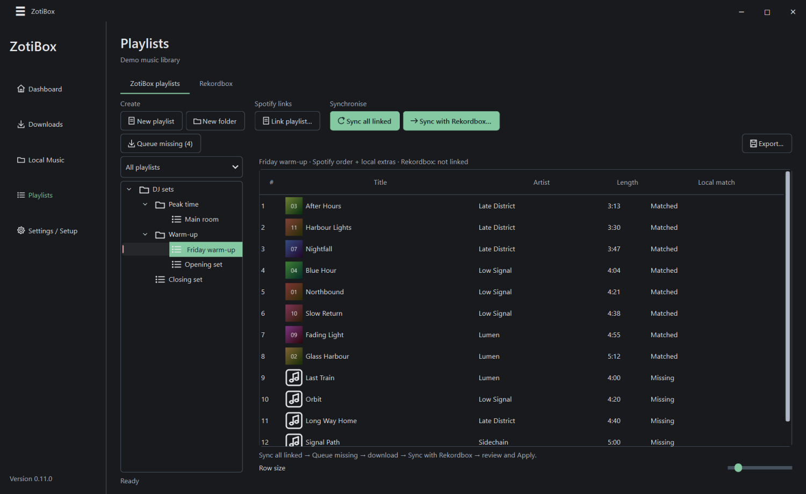
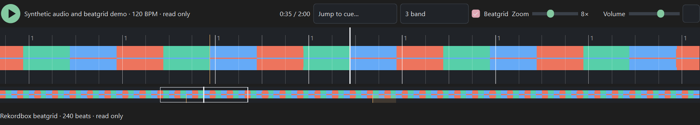
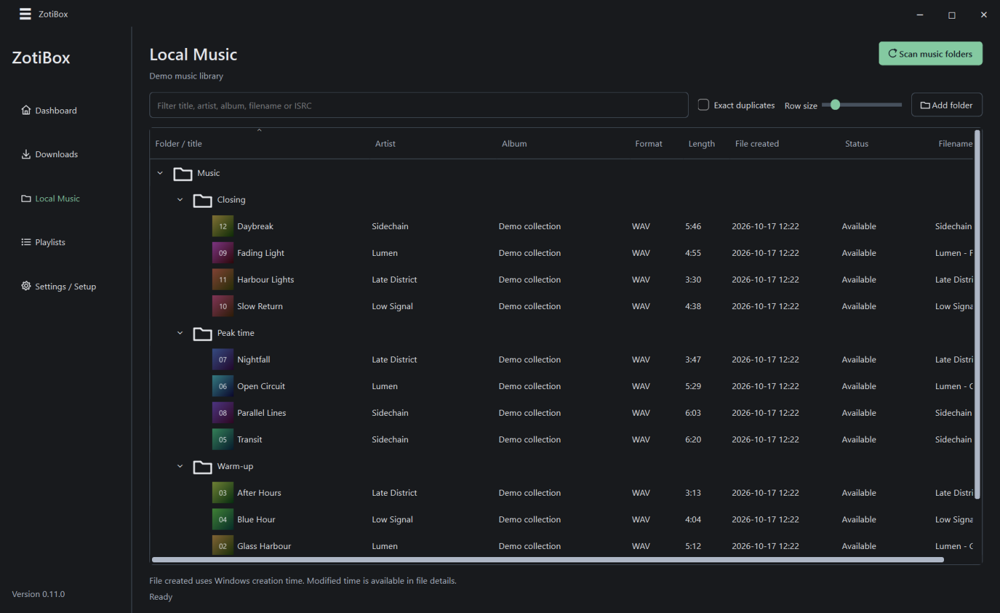
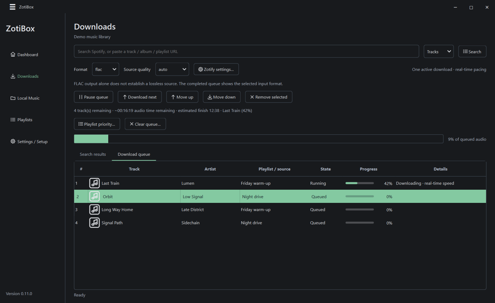
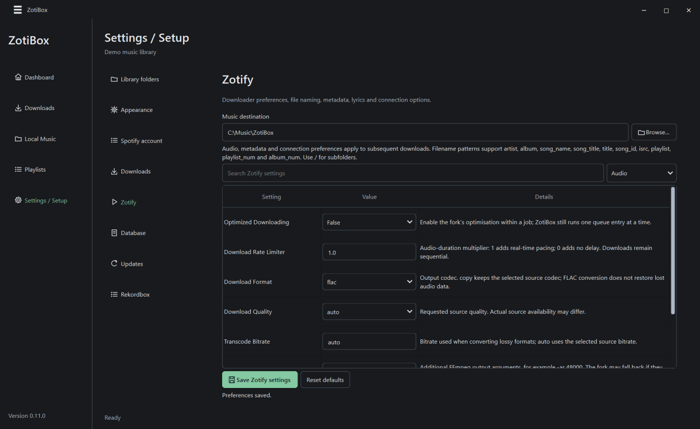

# ZotiBox

A Windows desktop app for organising local music, keeping Spotify playlists in sync, downloading through Zotify, and preparing Rekordbox library updates.

**[Download for Windows](https://github.com/Kit-Leeming/zotibox/releases/latest)** · [Report a bug](https://github.com/Kit-Leeming/zotibox/issues) · [Build from source](docs/BUILD.md)

## What it does

- Index music in existing folders, find duplicates and match local files to Spotify tracks.
- Keep linked playlists in Spotify order, review uncertain matches and queue missing tracks across the library.
- Download tracks, albums and playlists into one shared music folder, with progress and an estimated finish time.
- Preview playlist and metadata changes for Rekordbox, then apply them with verified backups.
- Browse folder trees, drag tracks and playlists, and preview audio with frequency-colored waveforms, zoom and existing Rekordbox cue/grid data.
- Customise colours, gradients and row sizes. Collapse navigation for more workspace.

Screenshots use generated demo data.

Local music and download queue screenshots

## Install

Download and run the latest installer on **Windows 10 or 11, 64-bit**. Updates install over the existing version; uninstalling first is unnecessary. ZotiBox checks for updates at startup and also under **Settings → Updates**.

The catalogue is stored in **ZotiBox Database** beside the application. Use **Settings → Database** to choose another location. Music stays in its existing folders unless you explicitly move or delete it.

## Connect your library

1. **Settings → Library folders:** add music folders, then scan from Local Music.
2. Create a Web API app in the [Spotify Developer Dashboard](https://developer.spotify.com/dashboard) and register both redirect URIs:
   - `http://127.0.0.1:4381/callback`
   - `http://127.0.0.1:4381/login`
3. **Settings → Spotify account:** enter the Client ID and connect. No client secret is required. The account must have access to the developer app; development-mode users need their own app or an allowlist invitation.
4. **Settings → Downloads:** choose the music destination and connect Zotify. Its streaming and developer authorisations may each open a browser. Saved valid logins are reused; use **Fresh Zotify login** to reconnect explicitly.
5. **Settings → Rekordbox:** select `master.db` and connect. Rekordbox **7.2.11** is the tested version.

## Spotify to Rekordbox

**Link playlist → Sync all linked → Review needed → Queue missing → Start downloads → Sync with Rekordbox → Preview → Apply**

Paste a Spotify playlist into search to create a new sync. Spotify controls its songs and order. Add local extras by dropping tracks onto the linked playlist; these stay after the Spotify songs and survive resync. Independent local playlists remain editable. **Queue missing** covers every linked playlist and keeps you on the current page. In review, **Not in local library** makes a track eligible for that queue. Weak candidates are classified as missing; strong but ambiguous candidates remain for review.

**Sync with Rekordbox** lets you choose multiple playlists to create or update. Missing files are skipped, including when creating an empty playlist; sync again after downloading. Rekordbox changes stay in a preview until Apply. Right-click a playlist and choose **Link / sync with Rekordbox** to choose an existing target. Existing native extras and the target name are kept; later syncs remove only songs previously managed by ZotiBox.

In **Downloads → Download queue**, drag pending tracks to reorder, choose **Download next**, or use **Playlist priority** to move whole playlists ahead. Shared tracks download once. Right-click actions apply to the selected rows; **Remove selected** removes entries, and **Clear queue** removes the whole list while keeping downloaded music. Removing the active entry stops it and resumes the remaining queue unless paused.

**Settings → Zotify** provides searchable audio, filename, metadata, lyrics and connection preferences. Filename patterns support subfolders, such as `{artist}/{album}/{song_name}`. Preferences apply to subsequent downloads; credential storage and verified staging stay within the app’s integration.

For Spotify on your phone, right-click a linked playlist → **Export local extras for phone**. The ZIP contains unchanged audio and transfer instructions. Add the files using Spotify’s Local Files feature on each device. Spotify’s Web API cannot add local files or upload private audio into its catalogue. See [Spotify’s instructions](https://support.spotify.com/article/local-files/).

## Backups and current limits

- Rekordbox can stay open for viewing and preparing previews. Close it before Backup, Apply or Restore. Database writes are disabled initially. Apply reuses its verified backup while the native library matches the last successful ZotiBox apply; external changes or a missing backup require a new one. Restore always makes a recovery backup. A visible warning indicates when Rekordbox is running. External music files are not included in those backups.
- Track identities, existing cues and analysis data are preserved where possible. New tracks need Rekordbox analysis. Waveforms offer RGB, 3 band, blue, accent and existing Rekordbox RGB modes, with zoom and an overview strip. Existing beatgrids and cue markers are read-only; missing grids are not invented. Cue/grid editing and automatic structural cues are future work, and and metadata edits affect the Rekordbox database rather than audio-file tags.
- Zotify downloads one track at a time, with real-time pacing by default. Finish estimates exclude login, conversion and retry delays. FLAC requests prefer a Spotify FLAC stream. Lossy fallback defaults to MP3 320 kbps for DJ compatibility; **Settings → Downloads** can preserve the original format instead. MP3 conversion adds another lossy encoding step. Source-format information verifies the delivered stream, not the original studio master or previously imported files.
- Spotify playlist folders are unavailable through the Web API. ZotiBox provides its own folders. Automatic PC-to-PC sync is not included; manual `.zotibox` export/import is available.

Zotify integration uses the [ZahBoy fork](https://github.com/ZahBoy/zotify). Dependency licences and attribution are listed in [third-party notices](THIRD-PARTY-NOTICES.md).
